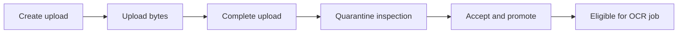

# Tesserix Document Intelligence

[](https://github.com/tesserix/document-intelligence/actions/workflows/ci.yml)
[](https://github.com/tesserix/document-intelligence/actions/workflows/license-compliance.yml)
[](https://github.com/tesserix/document-intelligence/actions/workflows/release-image.yml)
[](LICENSE)

Open-source, multi-tenant OCR and document-intelligence service for product
backends and AI agents. Self-host it with your own infrastructure and credentials.

## Start here

| I want to… | Go to |
| --- | --- |
| Deploy my own instance | [Self-hosting guide](docs/SELF-HOSTING.md) |
| Use my GCS, S3 or Azure storage | [Storage, IAM and API secrets](docs/BRING-YOUR-OWN-STORAGE.md) |
| Try sample images | [Three-image quick test](benchmarks/README.md#quick-test-three-images) |
| Integrate the API | [API usage guide](docs/design/OCR-API-USAGE.md) · [OpenAPI specification](contracts/v1/openapi.json) |
| Evaluate OCR quality | [Benchmark suite](benchmarks/README.md) |
| Prepare for production | [Release checklist](docs/RELEASE-READINESS.md) |
| Contribute a change | [Contributing guide](CONTRIBUTING.md) |

## Project status

**Used by Kora · Self-hosting beta · Apache-2.0**

- **Bring your own infrastructure:** the license does not include Tesserix
  services, customer data, cloud credits. The updated execution worker uses native PDF text extraction;
  production keeps its deployed behavior until a reviewed rollout.
- **Know the limits:** synthetic benchmarks are regression tests, not a
  real-world accuracy guarantee. The native path reads embedded PDF text and
  requires manual review for scanned PDFs/images; it cannot measure food
  weight or determine how much someone ate from a photograph.
- **License:** commercial use, modification and redistribution are permitted
  subject to the [Apache-2.0 terms](LICENSE).

## Workflow status

The badges above link to the latest `main` results and historical logs.

| Workflow | What it checks or publishes |
| --- | --- |
| [CI](https://github.com/tesserix/document-intelligence/actions/workflows/ci.yml) | Rust quality, database coverage, secret scanning and container contracts |
| [License compliance](https://github.com/tesserix/document-intelligence/actions/workflows/license-compliance.yml) | Dependency licenses, bans and sources |
| [Release image](https://github.com/tesserix/document-intelligence/actions/workflows/release-image.yml) | Service and parser-sandbox images |

## Service scope

The service owns safe document intake, image quality analysis, OCR, layout
recovery, classification, schema-driven extraction, deterministic validation,
evidence, confidence, provider routing, and human-review routing. It does
**not** own agent reasoning or a review UI.

Products consume the same versioned HTTP API through generated clients. AI
agents consume the provider-neutral Australis tool backed by that API. Product
code never embeds the OCR engine or receives its GCS, CNPG or Valkey
credentials. Product-specific storage, prompts, policy and observability remain
consumer integrations around the shared service.

## Repository boundaries

<details>
<summary>Ownership across the Tesserix repositories</summary>

| Repository | Ownership |
| --- | --- |
| `document-intelligence` | OCR, API, workflows, adapters, and evaluations |
| `tesserix/ai-agents` | Document agents and workflows on Tesserix ADK 0.54.0 |
| `tesserix/australis` | MCP/tool registration and cross-product integration |
| `tesserix/devai` | Sandboxes, golden suites, traces, and promotion gates |


</details>

## Design record

<details>
<summary>Architecture, contracts, security and decision records</summary>

- [Requirements](docs/REQUIREMENTS.md)
- [Design review tracker](docs/DESIGN-REVIEW.md)
- [High-level design](docs/design/HLD.md)
- [API and data contracts](docs/design/CONTRACTS.md)
- [OCR API usage guide](docs/design/OCR-API-USAGE.md)
- [Canonical v1 OpenAPI](contracts/v1/openapi.json)
- [Canonical v1 contract manifest](contracts/v1/manifest.json)
- [Quality, routing, validation, and review](docs/design/QUALITY-AND-REVIEW.md)
- [Rust OCR engine](docs/design/RUST-OCR-ENGINE.md)
- [Data architecture](docs/design/DATA-ARCHITECTURE.md)
- [Kora runtime storage integration](docs/design/KORA-RUNTIME-STORAGE.md)
- [Sandbox, evaluation and training data](docs/design/SANDBOX-EVALUATION-TRAINING.md)
- [Evaluation and tracing](docs/design/EVALUATION-AND-TRACING.md)
- [Agent development, evaluation, publication, and product runtime](docs/design/AGENT-DELIVERY-LIFECYCLE.md)
- [Threat model](docs/security/THREAT-MODEL.md)
- [Delivery plan](docs/PLAN.md)
- [ADR-0001: service and repository boundaries](docs/adr/0001-service-boundaries.md)
- [ADR-0002: durable document workflows](docs/adr/0002-durable-document-workflows.md)
- [ADR-0003: untrusted content and evidence](docs/adr/0003-untrusted-content-and-evidence.md)
- [ADR-0016: Native document processing without AI](docs/adr/0016-native-document-processing.md)
- [ADR-0017: Hybrid OCR for photos and image-only pages](docs/adr/0017-hybrid-photo-ocr.md)
- [ADR-0004: Rust-native OCR engine](docs/adr/0004-rust-native-ocr-engine.md)
- [ADR-0005: CNPG, Qdrant, and Valkey](docs/adr/0005-data-platform.md)
- [ADR-0006: Kora runtime storage as a consumer integration](docs/adr/0006-kora-runtime-storage.md)
- [ADR-0007: sandbox, training, and held-out evaluation boundaries](docs/adr/0007-sandbox-evaluation-training-boundaries.md)
- [ADR-0014: cloud-neutral storage](docs/adr/0014-cloud-neutral-storage.md)
- [ADR-0009: signed workload identity envelope](docs/adr/0009-signed-workload-identity-envelope.md)

</details>

## Delivery gates

Before deploying a new installation, confirm:

- **Data policy:** residency regions and retention defaults.
- **Access and ownership:** supported identity issuer and review-application owner.
- **Infrastructure:** launch scale, CPU/memory budgets and Temporal hosting model.
- **Quality and cost:** thresholds from the evaluation plan.

## Runtime guide

Use the [self-hosting guide](docs/SELF-HOSTING.md) for installation commands.
The reference below explains configuration and runtime safeguards.

### Base configuration

| Variable | Purpose |
| --- | --- |
| `DATABASE_URL` | Required PostgreSQL connection |
| `RESULT_BUCKETS` | Comma-separated allowlist of product/environment result buckets |
| `QUARANTINE_BUCKETS` | Isolated upload buckets, as comma-separated `product=bucket` entries |

GCS defaults remain compatible with existing workload identities. For S3/Azure
resource routes, cloud credentials and the required migration, see the
[storage guide](docs/BRING-YOUR-OWN-STORAGE.md). Real-cloud S3/Azure qualification
is still pending.
A missing adapter keeps readiness at **HTTP 503**; liveness stays available for diagnostics.

### Workload identity, caching, and telemetry

#### Signed workload identity

`OCR_WORKLOAD_IDENTITY_KEYS` is **required**, supplied only from Secret Manager
to the OCR workload. Each entry has this format:

```text
key_id=product:hex_key
```

- Use a rotation-safe key ID and a hexadecimal HMAC key of **at least 32 bytes**.
- Each product adapter holds only its own key.
- Authenticate the user session, then sign the tenant, timestamp, method and URI.
- Missing, malformed, stale or mismatched envelopes are rejected.

See [ADR-0009](docs/adr/0009-signed-workload-identity-envelope.md) for the contract.

#### Optional job-status cache

Set `VALKEY_URL` to enable caching. **PostgreSQL remains authoritative:** cache
misses, invalid entries, timeouts and errors fall back to the same product- and
tenant-scoped database lookup.

<details>
<summary>Cache defaults, tuning and contract test</summary>

| Setting | Default |
| --- | --- |
| `JOB_STATUS_CACHE_ACTIVE_TTL_SECONDS` | 10 seconds |
| `JOB_STATUS_CACHE_TERMINAL_TTL_SECONDS` | 300 seconds |
| `JOB_STATUS_CACHE_TIMEOUT_MILLISECONDS` | 25 milliseconds |
| `JOB_STATUS_CACHE_MAXIMUM_RECORD_BYTES` | 512 bytes |

Values can be tuned within hard limits. Entries are scoped by schema, product,
tenant and job; contain only status and creation metadata; and always expire.
Terminal-job entries are immutable.

Run the digest-pinned real-Valkey contract check:

```sh
scripts/test-valkey-cache.sh
```

It verifies an expiring scoped round trip and bounded rejection of oversized
values without coupling the reusable PostgreSQL CI job to Valkey.

</details>

#### Telemetry

| Configuration | Behavior |
| --- | --- |
| No `OTEL_EXPORTER_OTLP_ENDPOINT` | JSON-only tracing |
| Endpoint configured | OTLP/gRPC to a loopback collector or fully qualified Kubernetes `*.svc.cluster.local` gateway; requires canonical `DEPLOYMENT_ENVIRONMENT` |

**Do not put product telemetry credentials in this service.**
`OTEL_EXPORTER_OTLP_HEADERS` and `OTEL_EXPORTER_OTLP_TRACES_HEADERS` are refused.
Product-specific Langfuse credentials belong behind the product's telemetry gateway.
The exporter bounds connection/export timeouts and flushes on graceful shutdown.

### Upload lifecycle



Only an **accepted** upload can start a job for the same verified product and tenant.
A running ClamAV scanner and dispatch worker are required for acceptance.

<details>
<summary>Upload API, quarantine and inspection guarantees</summary>

`POST /v1/ocr/uploads` accepts only declared MIME, byte length, and canonical
SHA-256 plus `Idempotency-Key`. It issues a ten-minute HTTPS PUT capability for
an opaque service-generated object. The caller must send the returned headers.
`POST /v1/ocr/uploads/{upload_id}/complete` streams the object from its isolated
bucket, pins its exact GCS generation, hashes outside the async executor, and
checks byte length plus content-derived MIME before recording one durable
outbox event. Reconciliation leaves the object in `uploaded` quarantine state;
it cannot start a job. The acceptance store records the immutable promoted
source locator and a second content-free outbox event atomically, and only that
`accepted` state can start a job for the same verified product and tenant.
Inspection uses a five-minute, tenant-scoped CNPG lease: duplicate delivery by
the same worker renews it, another worker is excluded, an expired lease is
reclaimable, and ten exhausted attempts atomically reject the upload and emit a
content-free event. Acceptance also persists the bounded page count, maximum
and aggregate pixel counts, and parser profile/version; document text never
enters upload metadata or events. The dispatch worker performs quarantine inspection before OCR processing.

</details>

<details>
<summary>Malware scanning and source promotion</summary>

The malware adapter implements the bounded ClamAV `INSTREAM` protocol over a
loopback-only TCP connection to a separately sandboxed sidecar. It streams only
the recorded GCS generation, rechecks generation and length, caps chunks,
response bytes, total bytes and wall time, and treats unknown replies or scanner
failure as unavailable rather than clean. The dispatch worker invokes it during upload inspection; a running scanner and
dispatch worker are required for uploaded documents to become accepted.

The source-promotion adapter uses GCS rewrite with the exact quarantined source
generation and destination `ifGenerationMatch=0`. Its destination is a
tenant/product-scoped SHA-256 path. A replay after an ambiguous successful copy
streams and hashes the existing destination before returning its pinned
generation; mismatched bytes fail closed. The dispatch worker invokes this adapter after successful inspection.

</details>

<details>
<summary>Isolated parser and resource limits</summary>

`ocr-parser-sandbox` is a separate no-network parser executable and image. It
accepts document bytes only on standard input, verifies PDF or declared image
format, bounds encoded bytes, PDF objects, pages, per-page pixels, and aggregate
render pixels, and emits only a small JSON metadata report. Malformed input,
password protection, and limit violations use stable content-free exit codes.
The importer-side process adapter now adds a bounded stdin/stdout protocol, a
two-minute hard ceiling on its configurable deadline, kill-on-timeout, strict
metadata decoding, and stable invalid/limit/password/unavailable outcomes.
Production use still requires the reviewed disposable runtime profile.

</details>

### Source acceptance and promotion

<details>
<summary>Transactions, retries and failure handling</summary>

The importer coordinator now composes the short CNPG lease transaction with
exact-generation scanning and reading, bounded parsing, create-only promotion,
and a final atomic acceptance or permanent rejection. Dependency outages leave
the lease recoverable for bounded retry; foreign scope, stale ownership, source
conflicts, password requirements, and hard parser limits fail closed without
placing document content in database events.

</details>

### Durable workflow dispatch

<details>
<summary>Outbox leases and duplicate-execution prevention</summary>

Job workflow dispatch now uses a tenant/product-scoped CNPG outbox lease with
`SKIP LOCKED`, a 100-event batch ceiling, five-minute crash recovery and a
20-attempt dead-letter bound. The relay derives `ocr-job-{job_id}`, dispatches
start or cancellation outside the transaction, and acknowledges only with the
same live lease. An ambiguous Temporal start is therefore replayed with the
same workflow identity instead of creating duplicate execution.

</details>

## Contributing and license

This is an open-source project released under the
[Apache License 2.0](LICENSE). See [CONTRIBUTING.md](CONTRIBUTING.md) for the
development workflow, [SECURITY.md](SECURITY.md) for how to report
vulnerabilities, and [CODE_OF_CONDUCT.md](CODE_OF_CONDUCT.md) for community
expectations.

## OCR-only sandbox

The optional [OCR sandbox UI and API](docs/OCR-SANDBOX.md) supports bounded image
uploads, known-sample benchmarks, session isolation and durable image cleanup.
It runs as a separate service with isolated storage and credentials; public
admission is disabled by default.
